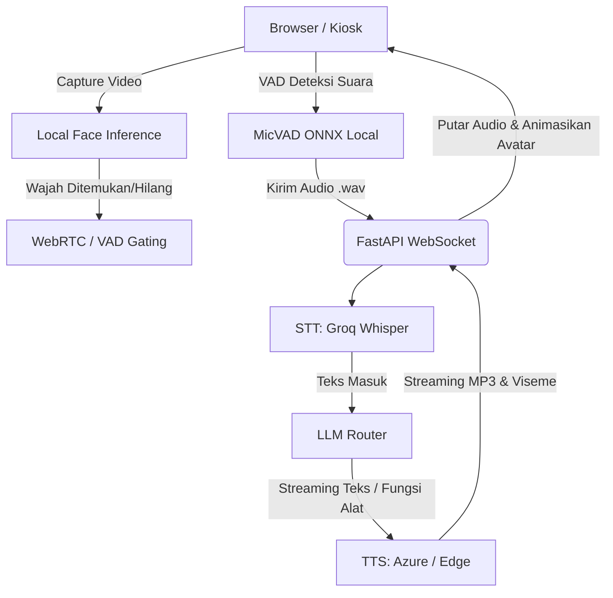

# Dokumentasi Teknis Proyek: Pointer (Asisten Kampus AI)

> [!NOTE]
> Dokumentasi ini disusun berdasarkan analisis menyeluruh pada *source code*, konfigurasi, dependensi, dan arsitektur aplikasi Pointer. Ditujukan sebagai dokumentasi tingkat *enterprise* untuk diserahkan kepada perusahaan, klien, atau komunitas *open source*.

---

## 1. Project Overview

### 1.1 Identitas Proyek
- **Nama Proyek:** Pointer
- **Slogan / Deskripsi:** Asisten Kampus (Voice chat with an AI avatar — companion + customer service)
- **Status:** Dalam pengembangan aktif (Mendukung integrasi RAG, Face Recognition, STT, LLM, dan TTS).

### 1.2 Tujuan Proyek
Mengembangkan asisten virtual interaktif berbasis suara dan pengenalan wajah untuk memberikan informasi, pelayanan, serta panduan di lingkungan kampus secara *real-time*.

### 1.3 Latar Belakang & Masalah yang Diselesaikan
Mencari informasi di lingkungan kampus secara spesifik kadang memakan waktu. Mahasiswa, dosen, atau pengunjung butuh pusat informasi interaktif yang cerdas. Dengan Pointer, permasalahan pencarian informasi konvensional diselesaikan melalui interaksi natural (berbicara di depan kamera) alih-alih mengetik pada kolom pencarian.

### 1.4 Ruang Lingkup & Target Pengguna
- **Ruang Lingkup:** Aplikasi web berbasis arsitektur *Client-Side Heavy* (kamera dan deteksi suara jalan di browser klien) terhubung via WebSocket ke *Server-Side AI Pipeline* (FastAPI).
- **Target Pengguna:** Mahasiswa, staf administrasi, dosen, dan pengunjung institusi pendidikan.

### 1.5 Objective & Keunggulan Proyek
- **Objective:** Merangkai siklus komunikasi latensi sangat rendah: Wajah Terdeteksi → Suara Direkam → Teks Ditranskrip (STT) → Dibalas oleh LLM → Disintesis jadi Suara (TTS) → Avatar 3D merespons dengan bibir bergerak sinkron (Lip-Sync).
- **Keunggulan Proyek:**
  - **Sistem Modular & Router LLM:** Sistem ini secara otomatis menyeimbangkan beban (*round-robin*) dan *auto-fallback* ke NVIDIA NIM, Groq, atau OpenRouter, meminimalisir risiko kegagalan respons (API mati / Limit).
  - **Continuous/Adaptive Face Learning:** Sistem secara dinamis menambahkan *embedding* wajah pengguna saat sistem sangat yakin (similarity tinggi), sehingga asisten makin kebal terhadap perubahan ekspresi atau pencahayaan wajah pengguna dari hari ke hari tanpa registrasi ulang.
  - **Desain UI Glassmorphism:** Implementasi antarmuka estetik yang transparan menyerupai kaca buram (Glassmorphism) menggunakan `backdrop-blur-md`.

### 1.6 Use Case Utama & Fitur
1. **Adaptive Greeting:** Sistem mengenali wajah pengguna yang menghadap layar dan menyapanya dengan namanya (jika sudah terdaftar). Jika belum, sistem menawarkan registrasi/enrollment lewat ucapan suara.
2. **Real-time Voice Conversation:** Pengguna berbicara tanpa menekan tombol. *Voice Activity Detection* (VAD) otomatis mendeteksi saat pengguna mulai dan berhenti bicara.
3. **Academic Web Search:** Apabila ditanya soal informasi spesifik kampus, LLM dapat memanggil *tool* mesin pencari (*Tavily*) untuk mengekstrak data terbaru dari domain `.ac.id` dan `.go.id`.
4. **Visual Feedback:** Balasan AI diterjemahkan kembali menjadi audio secara *streaming* dan diterjemahkan menjadi animasi pergerakan bibir (*viseme*) secara presisi di klien.

### 1.7 Keterbatasan Sistem
- Sinkronisasi bibir (*Lip-Sync*) versi Edge TTS/Azure masih mengestimasi *word boundary* berdasarkan proporsi durasi dan jumlah karakter (belum setingkat analisis fonem audio absolut).
- Kualitas *Face Recognition* sangat bergantung pada resolusi kamera, jarak wajah dari lensa, serta konsistensi *lighting* di ruangan.

---

## 2. Teknologi yang Digunakan

Proyek Pointer dibangun dengan *stack* modern pemisahan ketat antara *frontend* dan *backend*.

### 2.1 Frontend Stack
- **React 19 & Next.js 16 (App Router):** Framework utama untuk rendering UI dengan *fast-refresh*. Menawarkan manajemen *routing* yang terprediksi.
- **TypeScript:** Meminimalisir *runtime error* dengan pengecekan statis yang kuat, sangat berguna untuk mendefinisikan *payload* WebSocket (*Types.ts*).
- **Tailwind CSS 4:** *Utility-first styling*. Digunakan untuk membuat tema *Glassmorphism* (`backdrop-blur-md`, `bg-white/40`, `border-white/40`) pada UI percakapan, sesuai dengan estetika kaca buram transparan.
- **Zustand:** Manajemen state global yang sangat ringan. Mengelola antrian pemutaran audio (`audioQueue.ts`), manajemen *connection status*, serta mengunci mic saat AI sedang bicara agar tidak terjadi kebocoran suara.
- **@ricky0123/vad-web (Silero VAD):** Menjalankan *Voice Activity Detection* (ONNX model) di sisi *browser* (Client) agar mic hanya mengirimkan paket data audio saat ada suara manusia (*minSpeechMs: 200*, *redemptionMs: 1500*).
- **Three.js & @pixiv/three-vrm:** Merender file `.vrm` (model 3D Avatar standar VTuber) dan melakukan kalkulasi rotasi kepala, simulasi bernapas (idle animation), dan manipulasi *blendshape* bibir untuk *Lip-Sync*.
- **Lucide React:** Library ikon yang digunakan secara eksklusif (menggantikan emotikon teks untuk estetika yang lebih profesional).
- **Sonner:** Custom Toast UI estetik untuk notifikasi (sukses/error), menggantikan `alert()` bawaan sistem (Native alert dihindari).

### 2.2 Backend Stack (Python 3.11)
- **FastAPI & Uvicorn:** Framework berbasis *asyncio* untuk *Routing* WebSocket (koneksi utama obrolan) dan REST Endpoint (Pendaftaran Wajah).
- **InsightFace (`buffalo_l` model):** Pustaka pendeteksi (*SCRFD*) dan ekstraksi wajah (*ArcFace*). Dipilih karena menghasilkan *embedding vector* 512-dimensi yang sangat stabil dengan akurasi terdepan.
- **NumPy & SQLite:** Kombinasi cerdas untuk penyimpanan. Metadata disimpan dalam SQLite murni, sedangkan pencocokan wajah dilakukan di memori via *K-Means Unit Sphere Matmul* dengan NumPy yang sangat cepat.
- **Groq, NVIDIA NIM, OpenRouter:** Kumpulan SDK LLM untuk orkestrasi logika obrolan dan pemanggilan *tools*. Dirotasi (Round-Robin) menggunakan modul *LLMRouter*.
- **Edge TTS & Azure Cognitive Services:** Sintesis teks ke suara. Edge TTS dipakai karena gratis, sementara Azure dipakai jika *SSML prosody* dan *rhythm* alami diperlukan.
- **Tavily-Python:** *Library* web search AI yang diperintahkan dengan pencarian parameter yang dikhususkan pada domain akademik lokal.
- **ChromaDB:** Basis data vektor (lokal) untuk modul *Retrieval-Augmented Generation* (RAG) jika asisten mencari data statis internal kampus.
- **Loguru:** Alat pencatatan (*logging*) mutakhir di CLI.

---

## 3. Arsitektur Sistem & Pipeline Data

### 3.1 Flow Arsitektur Utama (Client-Side Heavy)

### 3.2 Pipeline Voice (WebSocket Streaming)
Semua komunikasi berlangsung di atas satu saluran **WebSocket**.
1. **Audio Segment Masuk (`audio_chunk`, `audio_end`):** Saat jeda bicara (VAD *triggered*), frontend mengubah `Float32` PCM ke WAV Base64 (`wav.ts`) lalu mengirimnya ke server.
2. **Orkestrasi (`orchestrator.py`):**
   - **STT (Speech-to-Text):** Mentranskrip suara menjadi teks.
   - **LLM Routing:** Teks dilempar ke LLM bersama riwayat obrolan (`chat_history`). Jika LLM memanggil *tool* web search, pencarian via Tavily dieksekusi dulu secara asinkron.
   - **Streaming Teks & Flushing:** Teks balasan dipecah per-kalimat. Setiap kali satu kalimat selesai, kalimat tersebut dilempar (di-*flush*) secara *streaming* ke modul TTS.
   - **TTS & Viseme:** Modul TTS mensintesis suara, mengembalikan data byte MP3 beserta data estimasi suku kata/karakter (Word Boundary). Sistem mentranslasi karakter ini (misalnya `a`, `i`, `u`, `sh`, `ch`) ke standar viseme `VisemeEvent` (`viseme.py`).
3. **Audio Playback (`audioQueue.ts`):** Di frontend, audio diputar berurutan (*gapless MP3 playback*). *Event listener* menyesuaikan `VisemeEvent` ke dalam kontrol gerakan (*blendshape*) model 3D (`LipSync.ts`).

### 3.3 Sistem Face Recognition & Adaptive Learning
Sistem wajah (*Face Recognition*) didesain asinkron untuk tidak memblokir pergerakan UI kamera (*CameraView.tsx*):
- Frontend secara konstan memindai gambar kamera (maksimum resolusi 320px) pada 2 FPS ke REST API `/api/face/recognize`.
- Di Backend, `InsightFace` akan mengekstrak vektor wajah.
- Modul `SQLiteFaceDB` (dengan matriks *Numpy Centroid K-Means*) akan mencari skor kemiripan tertinggi (Cosine Similarity).
- **Adaptive Enrollment:** Jika kecocokan > 65% (`face_adaptive_threshold`), server akan menambahkan titik fitur wajar terbaru ini ke database (`enroll`) hingga 20 referensi (`face_max_emb_per_person`). Ini menjadikan sistem tidak mudah tertipu karena beda kacamata atau gaya rambut seiring waktu.

---

## 4. Struktur Direktori dan Penjelasan File

### 4.1 Root & Konfigurasi
- **`docker-compose.yml`**: Pengaturan infrastruktur (frontend port 3000, backend port 8000), konfigurasi volume mounting database lokal ke `./data`.
- **`.env.example`**: Konfigurasi template untuk seluruh API keys (Groq, Tavily, NVIDIA, OpenRouter, Azure) dan setelan sistem (model, URL, dsb).

### 4.2 Backend (`/backend`)
Server API Python berbasis FastAPI yang mengelola intelijen sistem.
- **`app/main.py`**: Entrypoint FastAPI, mengatur *lifespan*, router, dan CORS middleware.
- **`app/config.py`**: Pydantic Settings untuk type-safe env loading.
- **`app/api/`**: 
  - `websocket.py`: Router WebSocket, *state-machine* percakapan (termasuk Face Engagement dan Enrollment by Voice).
  - `face.py`: REST endpoint khusus pengenalan dan pendaftaran wajah.
- **`app/core/`**:
  - `orchestrator.py`: Logika sistem (*The Brain*), menyatukan STT, LLM, TTS, Web Search, Viseme, dan manajemen pesan streaming LLM per kalimat (*flush* buffer).
  - `viseme.py`: Algoritma mapping untuk sinkronisasi bibir berbasis parsing *digraph* / karakter ke Oculus/VRM *viseme key*.
  - `rag.py`: Pengelola interaksi dengan ChromaDB Vector Database.
- **`app/recognition/`**:
  - `face_database.py`: Mesin database wajah dengan penyimpanan SQLite dan pencarian Cosine Similarity cepat menggunakan Numpy K-Means.
- **`app/services/`**: Modul pembungkus layanan pihak ke-3.
  - `llm_router.py`: Auto-fallback dan Round-robin load balancer.
  - `llm_groq.py`, `llm_nvidia.py`, `llm_openrouter.py`: Kelas adapter dengan API asinkron seragam.
  - `tts_edge.py`, `tts_azure.py`: Pengelola Text-to-Speech (dengan SSML prosody jika Azure).
  - `stt_groq.py`: Pembungkus Whisper API.
  - `search_tavily.py`: Layanan eksekusi web search dengan parameter pencarian domain lokal (`.ac.id`, `.go.id`).
  - `chat_history.py`: Database percakapan per identitas (person_id).
- **`pyproject.toml` & `Dockerfile`**: Konfigurasi package manager berbasis `uv` (cepat, Rust-based) dan deployment *container*.

### 4.3 Frontend (`/frontend`)
Klien interaktif Next.js (React 19) dengan Server/Client Components.
- **`app/page.tsx`**: Layout visual. Mengatur kerangka *Glassmorphism* dasar, serta *dynamic importing* komponen berat (Avatar, Kamera, VAD) agar tidak menahan *initial render*.
- **`components/`**:
  - `ChatInterface.tsx`: UI pesan percakapan, status koneksi, integrasi pemanggilan *tool/search sources*, *auto-scroll*.
  - `CameraView.tsx`: Mengontrol WebCam (*navigator.mediaDevices*), mengirim *frame* ke API (recognizeFace), dan menginterpolasi *bounding box* hasil *recognition* agar visual tampak 60 fps walau API jalan pada 2 fps.
  - `VadListener.tsx`: Pembungkus Silero VAD (lewat pustaka @ricky0123/vad-web), memastikan *mic gating* akurat (misal: mematikan mic jika LLM sedang menjawab, menghindari gema balik TTS).
  - `Avatar3D.tsx`: Menggunakan Three.js & @pixiv/three-vrm untuk merender Avatar `.vrm`. Menangani animasi bernapas (idle) dan mengaitkan *event listener* audio start/end untuk mengaktifkan *Lip-Sync*.
- **`lib/`**:
  - `store.ts`: Manajemen state terpusat via *Zustand*. Menangani siklus WS, status mic, status wajah, buffering pesan AI.
  - `audioQueue.ts`: Manajemen pemutaran antrian MP3 terpusat (menghindari suara tabrakan dengan pemutaran sekuensial *gapless*).
  - `lipSync.ts`: Menerjemahkan target viseme dari TTS ke dalam kurva mulus untuk parameter `expressionManager` VRM.
  - `faceApi.ts` & `websocket.ts`: Layer abstraksi jaringan ke *backend*.
  - `wav.ts`: Utility encoder Float32 PCM ke format WAV yang diterima STT.

---

## 5. Skema Penyimpanan Data (Database)

Proyek ini menggunakan dua penyimpan utama (berada di `/data`):

1. **`app.db` (SQLite):**
   - **Tabel `chat_turns`**: Menyimpan sejarah kronologis obrolan. Struktur utama: `[id, person_id, role, content, ts_iso]`. Menjamin percakapan yang berkelanjutan, asalkan pengguna tersebut dikenali dari data wajahnya.
2. **`faces.db` (SQLite):**
   - **Tabel `persons`**: Menyimpan profil unik (metadata pengguna).
   - **Tabel `embeddings`**: Menyimpan *raw Float32 numpy vector* dari InsightFace. Satu `person_id` bisa memiliki hingga 20 *embeddings* (berkat fitur *adaptive learning*).
3. **`chroma/` (ChromaDB):**
   - Data Vektor (RAG) statis, menyimpan dokumen atau pedoman internal kampus.

---

## 6. Pola & Standar Desain Kritis

1. **Pengelolaan LLM Resilience:** Backend menerapkan pola *Round-Robin & Fallback* pada modul `llm_router.py`. Apabila penyedia layanan (misalnya NVIDIA) terputus atau terkena *Rate Limit*, sistem seketika mengkarantina rute tersebut (jeda 60 detik) dan bergeser ke layanan lain (Groq/OpenRouter).
2. **WebRTC Echo Gating Mitigation:** UI memblokir VAD mendengarkan audio saat Avatar sedang menyuarakan teks. Modul `store.ts` dihubungkan ke `VadListener.tsx` sehingga mikrofon nonaktif (`paused`) persis ketika `assistantSpeaking` aktif, meniadakan loop audio.
3. **Penolakan Native UI (`alert()`):** Sesuai *guideline* sistem UI estetik, proyek secara sistematis memblokir seluruh *alert()* JavaScript *native* dan mendelegasikan penanganan pesan ke `Sonner Toast` untuk umpan balik instan yang elegan (misalnya saat izin *webcam* ditolak).
4. **Desain Visual Glassmorphism:** Memastikan gaya visual tidak membosankan (rata/flat), frontend diarsiteki dengan lapisan-lapisan transparan dengan *backdrop-blur* (*vibrant & lively*).

## 7. Rencana Masa Depan (Skalabilitas)

Area *improvement* untuk tahap lanjutan (Phase 5/6):
1. **Penyempurnaan Lip-Sync:** Algoritma pemetaan berbasis karakter/waktu di modul `viseme.py` dapat diganti/disinergikan dengan pustaka `espeak-ng` atau `phonemizer` untuk transisi mulut fonetik absolut standar bahasa Indonesia.
2. **Migrasi WebSocket → WebRTC Audio:** Walau mekanisme *Base64 chunking* di WS stabil, konversi murni ke WebRTC akan menghadirkan latensi di bawah 100ms dan *Echo Cancellation* bawaan browser.
3. **Pengoptimalan Aset VRM (Avatar):** Model 31MB direkomendasikan di-*compress* di sisi *mesh* (Draco/Meshopt) agar waktu rendering awal *initial loading* browser jauh lebih cepat pada perangkat mahasiswa.
